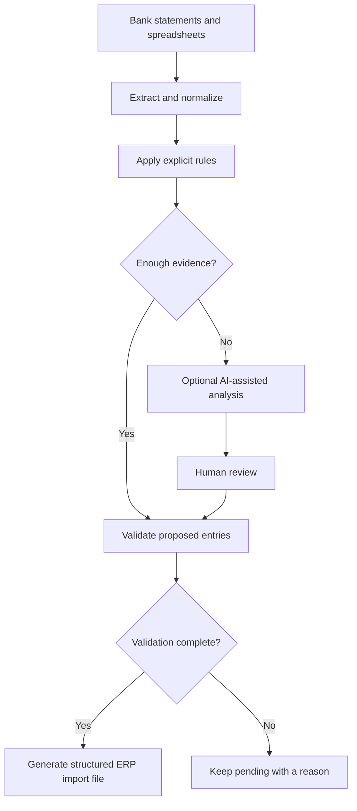

# Accounting automation with n8n

Financial inputs, explicit rules and human review before structured ERP output.

**Public architecture case study · Synthetic examples · Private implementation**

## Overview

I develop accounting automation to help process bank statements and spreadsheets,
normalize financial transactions, handle classification exceptions and prepare
structured accounting entries.

This repository explains the approach. It is a documentation-only portfolio:
there is no executable n8n export, application package or production deployment
in this public repository.

The implementation and its operational data remain private. The examples below
are fictional and do not establish production readiness or measured performance.

## The problem

Accounting workflows combine repetitive data preparation with decisions that
depend on evidence and company-specific rules. A useful automation needs to
organize those inputs, preserve uncertainty and make review possible before
generating an import file.

My work focuses on:

- designing and evolving n8n workflows;
- transforming and validating financial inputs;
- defining explicit processing rules and exception paths;
- integrating AI-assisted analysis without treating a suggestion as approval;
- preparing structured output for an accounting ERP workflow.

## Processing model



The diagram describes the workflow at an architectural level. It is not an
executable definition or a claim that every integration is publicly available.

### Decisions that matter

**Deterministic processing first.** Known cases follow explicit rules. Contextual
AI analysis is reserved for cases where it can help a reviewer.

**Review before acceptance.** A model response is a proposal. Unresolved or
ambiguous cases stay pending; confidence wording alone is not accounting evidence.

**Validation before output.** Required fields, amounts and classification decisions
must be checked before an import artifact is prepared.

**Company boundaries.** A rule or account mapping approved for one company is not
automatically valid for another.

**Traceable evolution.** Workflow changes and controlled regression cases make it
possible to compare behavior between versions. Those implementation artifacts are
maintained privately.

## Technology and scope

| Component | Role |
| :-- | :-- |
| n8n | Workflow orchestration, branching and integrations |
| JavaScript | Transformations and validation inside workflows |
| AI-assisted analysis | Contextual suggestions within a controlled review process |
| Structured text output | Preparation of accounting entries for ERP import |

The intended ERP context is Domínio. Actual import layouts require validation in
the target environment; the example below is deliberately not an import contract.

Python, FastAPI and PostgreSQL are part of my broader software work. They are not
presented as dependencies of this documentation-only repository.

## Synthetic example

A fictional transaction arrives with a date, description and credit amount:

```json
{
  "date": "2026-07-15",
  "description": "DEMO CUSTOMER RECEIPT",
  "amount": "1250.00",
  "direction": "credit",
  "source": "synthetic_portfolio_example"
}
```

1. Normalize the date, amount and transaction direction.
2. Check whether an approved rule can resolve the classification.
3. If evidence is insufficient, retain the item for review; AI may help propose
   a classification.
4. Validate the approved result before preparing output.

Illustrative output shape:

```text
DATE;DEBIT_ACCOUNT;CREDIT_ACCOUNT;AMOUNT;HISTORY_CODE;DESCRIPTION;COMPANY_CODE
```

These are placeholders, not valid account mappings or a ready-to-import file.

## Public evidence and limitations

**Available here:** the processing model, engineering decisions and a synthetic
input/output example.

**Not available here:** production workflows, client records, credentials,
confidential business rules, executable tests or a reproducible runtime package.

The private implementation continues to evolve. This case study does not publish
company counts, time savings or financial results because there is no supporting
measurement package in this repository. Tests and deployment checks must be run
against the authorized implementation and its target environment.

## Explore related work

My [GitHub profile](https://github.com/TheoMAS23) summarizes related work in
accounting audit software, document operations and web development. Private
projects are described at a high level without exposing their repositories.

- [Portfolio](https://theo-moron-portfolio.pages.dev/)
- [LinkedIn](https://www.linkedin.com/in/theo-moron-07904642b/)
- [Email](mailto:theomoron.anastaciosilva@gmail.com)
